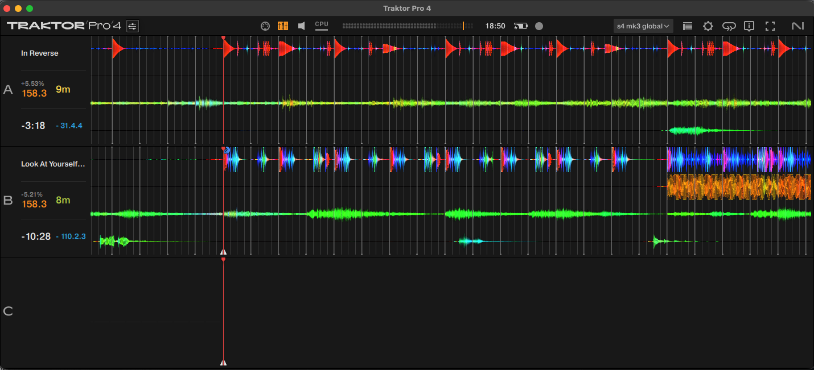
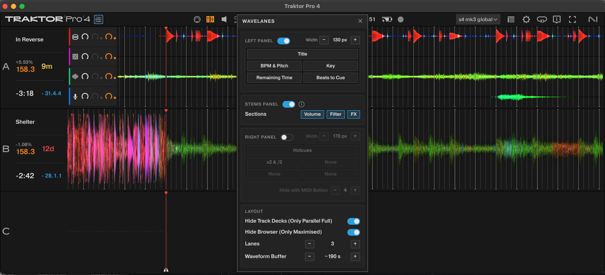

# WaveLanes

Parallel waveforms full screen, for Traktor Pro 4. An add-on for DJing with
Traktor's parallel waveforms taking the whole screen:

- **More room for the waveforms**: in the Parallel view, the track decks go
  and 3 or 4 lanes take the screen, at the height you choose. The waveform
  fills the whole lane, and stays sharp over a longer stretch of the track.
  The other views stay as they are.
- **Panels on each lane** with the track's information: title, artist, BPM,
  key, loop, remaining time, beats to the next cue, hotcues… You choose what
  goes where.
- **A stems panel** with volume, filter and FX for each stem, on Stem decks.
  It replaces Traktor's own stem controls, which are hidden.
- **A settings window**, opened from a button in Traktor's header, next to
  the logo.

Everything is applied to a **copy** of Traktor. The original installation is
never touched.

> **Disclaimer.** A personal, unofficial project, not affiliated with Native
> Instruments, which has neither reviewed nor endorsed it. Traktor is a
> trademark of Native Instruments GmbH.
>
> - It modifies a copy of the program and attaches to it while it runs.
>   Native Instruments does not support a modified copy; for any problem with
>   Traktor, use the original installation.
> - It does not touch anything to do with licensing or activation, nor does it
>   let anyone use Traktor without a licence: you need to have bought and
>   installed Traktor.
> - Read Traktor's licence agreement before using it. Doing so is each user's
>   own decision and responsibility.
> - It is provided as is, without warranty (see `LICENSE`). It may fail with
>   another Traktor version or hang it: test it well before using it in a
>   session that matters, and always keep the original installation at hand.

Tested on a Mac with apple silicon and Traktor Pro 4.5.0, and on Windows 11
with Traktor Pro 4.5.1.

## Installing

First, **download** this repo (*Code > Download ZIP* on GitHub), unzip it and
put the folder where it will stay, for example in Documents. WaveLanes
runs from it, so do not move or delete it afterwards.

### Mac

1. With Traktor closed, double-click **Install on Mac.command**. A
   Terminal window shows what it does; it takes a minute or two.
   - If macOS says it cannot check the file, go to *System Settings >
     Privacy & security* and click *Open Anyway*.
   - If macOS offers to install the command line tools (they bring Python),
     install them and open the file again.
   - macOS may ask for your login password, once: the installer adds a
     certificate to your keychain to sign the copy.
2. Open Traktor with **WaveLanes.app**, which the installer shows in
   Finder. Drag it to the Dock to have it at hand.

### Windows

1. With Traktor closed, double-click **Install on Windows.bat**. If Python
   is not installed, it offers to install it; then open the `.bat` again.
2. Open Traktor with the **WaveLanes** shortcut, on the desktop or in the
   Start menu. The first time it takes 15-20 s more.

### Then, in Traktor (once)

1. *Preferences > Controller Manager > Add… > Traktor > Kontrol Z1 MK2*. This
   is what turns the panels on; you do not need the controller. If you own a
   real Z1 MK2, see *Troubleshooting*.
2. *Preferences > Layout Manager*: in the **Parallel** layout, set the decks to
   the **Full** size. That is the size WaveLanes removes to make room for
   the lanes.
3. Quit Traktor and open it again with WaveLanes.

The installer can be opened again at any time: it skips what is already done,
so it also repairs an install (for example, after moving the folder).

## Using it

- Always open Traktor with **WaveLanes** (the app on Mac, the shortcut on
  Windows), not the copy itself: without it, the waveform is not stretched
  and the panels do not show.
- The **settings button**, right after the Traktor logo, opens the settings
  window. Panel changes apply at once. The **Layout** options (decks, lanes,
  lane height, waveform buffer) apply the next time Traktor is opened with
  WaveLanes; until then they show in blue. Hover over an option's name
  for what it does.
- In a short lane, the settings window marks in amber what does not fit.
- **Hide Browser** (in *Layout*) removes the browser under the lanes, so they
  share the whole height of the window, and the decks over the maximised
  browser. The browser then only opens maximised, in every view; the other
  views keep their decks, with black bands where the browser was.
- The panels hide outside the Parallel view, with the browser maximised and
  while a Traktor menu is open.
- The right panels cover Traktor's waveform zoom buttons. To reach them, hide
  the right panels for a moment, with their switch in the settings window or
  a MIDI note (*Hide with MIDI Button*: map a note to *MIDI Controls >
  Button N* in the Controller Manager).

## Updating Traktor

Update Traktor as usual, with Native Access. The next time you open Traktor
Custom, it offers to update its copy: it copies Traktor again and applies
your settings (a minute or so). Traktor's settings and collection are kept.

A new Traktor version can break parts of WaveLanes; see *For developers*.

## Uninstalling

Double-click **Uninstall on Mac.command** or **Uninstall on Windows.bat**.
It lists what it will remove (the copy, WaveLanes itself, your settings
and its log; on Mac also the certificate) and removes it after asking. The original Traktor,
its settings and your collection are not touched. Then delete the folder.

## Troubleshooting

- **The panels do not appear**: the Kontrol Z1 MK2 mapping is missing (step 1
  of *Then, in Traktor*). WaveLanes says so some 10 s after Traktor opens.
- **The track decks still show under the lanes**: set the Parallel decks to
  **Full** in the Layout Manager, and check that *Hide Track Decks* is on.
- **You own a real Z1 MK2**: the panels have to go in the mapping of another
  controller you do not have. Before opening WaveLanes the first time,
  change `CONTROLLER` in `src/layout_patch.py` to the name of that controller's
  folder in the copy's `qml/CSI/`, and add that controller in the Controller
  Manager instead.
- **Errors** are shown in a message. The log is in
  `~/Library/Logs/WaveLanes.log` on Mac and
  `%LOCALAPPDATA%\WaveLanes\WaveLanes.log` on Windows. On Windows,
  `src\windows\WaveLanes.bat` opens Traktor with a console that shows it
  live.

## For developers

### How it works

The code is in `src/` (paths below are from there); the installers at the top
only make the Python environment in it (`src/.venv`) and run
`mac/install_mac.py` or `windows/install_windows.py`.

- `layout_patch.py` patches the copy: the Parallel layout XML inside the
  executable, the waveform buffer (on Mac; on Windows the Frida script sets
  it), and the QML. The QML (`qml/`) is loaded by a launcher injected in the
  Kontrol Z1 MK2 mapping, and draws the panels and the settings window as Qt
  windows.
- A Frida script (`mac/wave_height_mac.js`, `windows/wave_height.js`),
  attached while Traktor runs, stretches the waveform, hides Traktor's stem
  controls and places the panels over the lanes.
- `mac/traktor_config.py` and `windows/traktor_config.py` apply the Layout
  settings before Traktor starts, only when they changed. On Mac each patch
  breaks the copy's signature, so it is signed again with the "WaveLanes"
  certificate the installer made: macOS ties privacy permissions to it, so it
  does not ask for them again.
- All the settings are kept in `settings.json`, written by the
  settings window, in the user's data folder (`ui_settings.py`):
  `~/Library/Application Support/WaveLanes` on Mac,
  `%LOCALAPPDATA%\WaveLanes` on Windows. A new download of this repo
  keeps them.
- On Mac the copy goes to `/Applications/Traktor Pro 4 WaveLanes.app`; another
  place can be given with
  `sh "Install on Mac.command" --copy "/path/to/the copy.app"`. On
  Windows it goes to `%LOCALAPPDATA%\WaveLanes\Traktor Pro 4 WaveLanes`,
  so it needs no administrator rights.

### Rules

- Always work on a **copy** of Traktor. The original installation is never
  touched.
- Nothing to do with licensing or activation is touched.
- Frida attaches **once** per Traktor session and is never detached:
  detaching it with Traktor open hangs it. To load a new version of the
  script, quit Traktor and open it again.
- No full memory scans with Traktor running.
- Before writing to Traktor's memory, do a dry run that logs what would be
  written. `wave_height_mac.py` without `--apply` does just that; the newer
  parts of the scripts have their own (`HIDE_DRY_RUN` and `CENTRE_DRY_RUN` in
  `wave_height_mac.js`, `HIDE_STEMS_DRY_RUN` and `CENTRE_DRY_RUN` in
  `windows/wave_height.js`), turned off once checked in the log.

### Another Traktor version

The patches find their data by content, not by position, but some values
were measured on one version and may move:

- **Mac** (4.5.0, in `mac/wave_height_mac.js`): the byte that shows Traktor's
  stem controls (`STEMS_SHOWN`), the IDs of the deck letter and zoom buttons
  (`CENTRED_IDS`) and the form offsets. Check them with the dry run, and with
  the read-only probes in `tools/probes/` (they detach when they finish, which
  can hang Traktor: only with a session you do not mind losing).
- **Windows** (4.5.1, at the top of each section of `windows/wave_height.js`):
  the executable has no symbols, so the functions the script calls are found
  by address and checked against their first bytes (`SET_STEMS_SHOWN`,
  `RESIZE_WAVEFORM`, `GET_CONTROL`, `MASTER_POPUP_CHECK`, `WAVE_BUFFER_INSN`).
  If one has moved, the script says so in the log and leaves that part as
  Traktor has it. The form offsets (`FORM_*`, `HOST_*`, `STEMS_*`) are not
  checked: if the waveform is not stretched or the panels are not placed,
  they need checking.
- Both: the `decks.N.type` path (2 = Stem).

To check the Layout settings against the copy without changing anything:
`mac/traktor_config.py --check` or `windows\traktor_config.py --check`, with
the `.venv` Python.

## Licence

The code and documentation in this repository are under the MIT licence
(`LICENSE`). They include and cover nothing of Native Instruments: neither
Traktor nor its files, fonts, images or trademarks.
